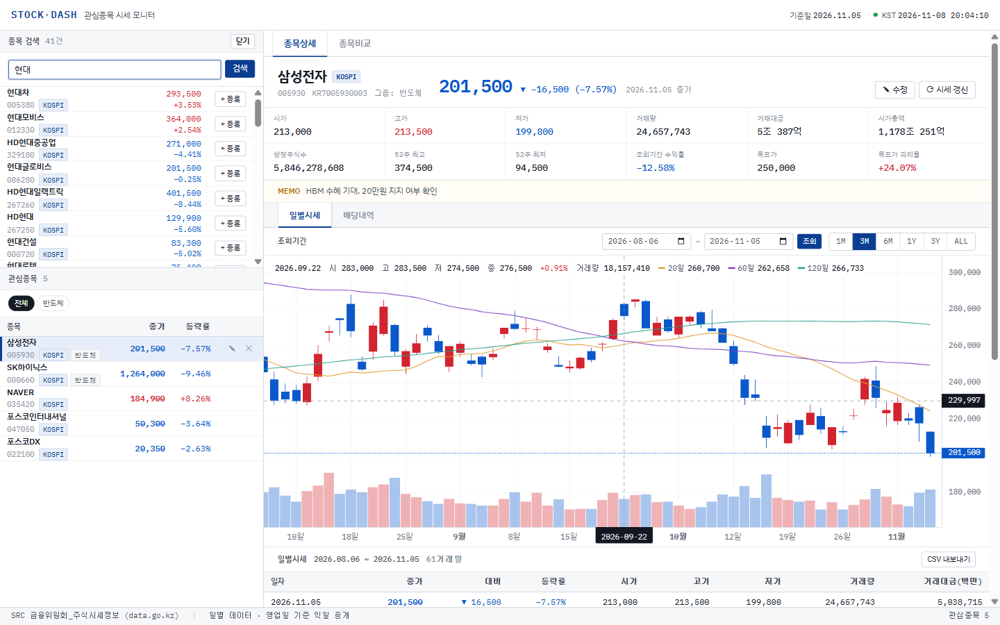
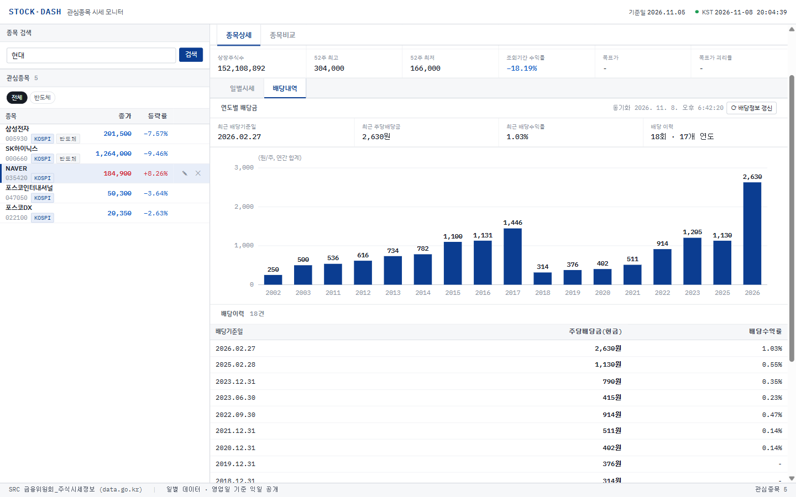
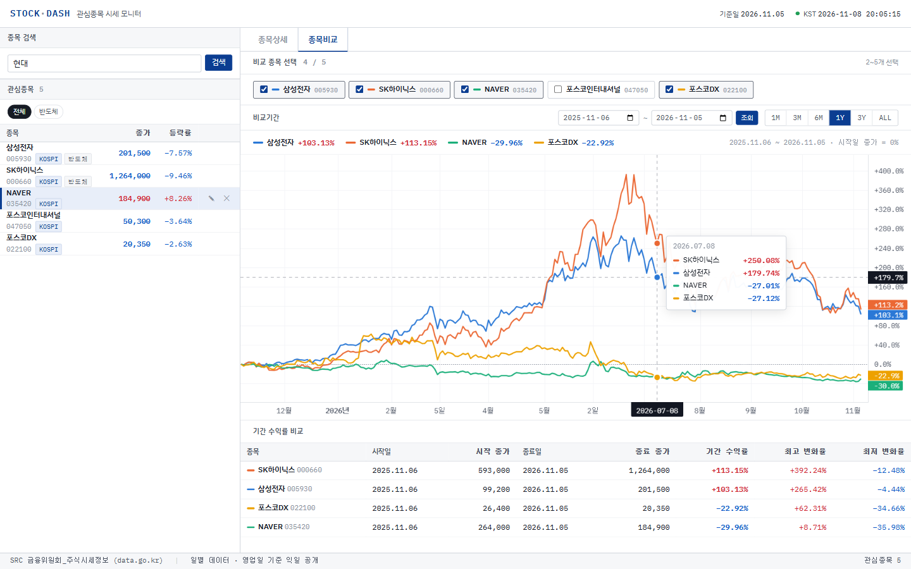

# STOCK·DASH — 관심종목 주식 대시보드

공공데이터포털의 **금융위원회 주식시세정보 · 주식배당정보 API**로 관심종목의 일별시세, 배당내역, 종목 간 수익률을 한 화면에서 보는 Next.js 웹앱입니다. 흰 배경의 전문가용 시스템 화면을 목표로 만들었습니다.

**🔗 데모:** https://stock-dash-tomas-664e.vercel.app



## 주요 기능

### 관심종목 관리
- 종목명 또는 종목코드로 **검색**하고 **[+ 등록]** (이미 등록한 종목은 "등록됨" 표시)
- **목록**: 종가·등락률 표시, 종목명·종가·등락률 정렬, 그룹 필터
- **수정**: 그룹, 목표가, 메모 (목표가를 넣으면 현재 종가 대비 괴리율 표시)
- **삭제**: 확인 창을 거쳐 삭제하며, 해당 종목의 시세·배당 캐시 파일도 함께 삭제

### 종목상세 – 일별시세
- 요약 12개 지표: 시가·고가·저가, 거래량·거래대금, 시가총액, 상장주식수, 52주 최고·최저, 조회기간 수익률, 목표가·괴리율
- **캔들 차트 + 거래량 + 20일·60일·120일 종가 이동평균선** (마우스를 올리면 해당 날짜 값 표시)
- **조회기간**: 1M / 3M / 6M / 1Y / 3Y / ALL 버튼, 또는 시작일·종료일 직접 입력
  - 저장된 데이터보다 이전 기간을 조회하면 그 기간을 API에서 자동으로 추가 수집
- 일별시세 표 (20행씩 페이지 이동) 및 **CSV 내보내기**

### 배당내역


- 연도별 주당배당금 **막대차트** (분기배당은 연도별로 합산)
- 배당이력 표: **배당기준일 / 주당배당금(현금) / 배당수익률**
- 배당수익률 = 주당배당금 ÷ 배당기준일 종가(휴장일이면 직전 거래일) × 100
- 배당기준일이 아직 오지 않은 배당은 **"예정"** 으로 표시
- 현금배당 기록이 없으면 **"배당이력이 없습니다."** 안내

### 종목비교


- 관심종목 중 **2~5개**를 체크박스로 선택
- 선택 기간의 **종가 변화율(%)** 을 한 차트에 표시 (시작일 종가 = 0%)
- 종목별 고정 색상 (다른 종목을 선택·해제해도 색이 바뀌지 않음)
- 범례에 종목명과 기간 수익률, 마우스를 올리면 날짜별 변화율 툴팁 (높은 순)
- 기간 수익률 비교 표: 시작·종료 종가, 기간 수익률, 최고·최저 변화율

## 기술 스택

| 구분 | 사용 기술 |
|---|---|
| 프레임워크 | Next.js 15 (App Router), React 19, TypeScript |
| 차트 | [lightweight-charts](https://github.com/tradingview/lightweight-charts) v5 (캔들·라인), SVG (배당 막대차트) |
| 데이터 | 공공데이터포털 금융위원회 API (주식시세정보 V2, 주식배당정보 V2) |
| 저장소 | 로컬 JSON 파일 (`data/`) |
| 스타일 | 순수 CSS (IBM Plex Sans KR / IBM Plex Mono) |

## 시작하기

### 1. 공공데이터포털 API 활용신청

[공공데이터포털](https://www.data.go.kr)에 로그인한 뒤 아래 두 API를 **활용신청**합니다 (개발계정 자동승인).

| API | 사용 오퍼레이션 |
|---|---|
| 금융위원회_주식시세정보 | `getStockPriceInfo_V2` |
| 금융위원회_주식배당정보 | `getDiviInfo_V2` |

인증키는 계정당 하나이며, 마이페이지에서 **일반 인증키(Decoding)** 를 확인합니다. 승인 직후에는 키가 반영되기까지 시간이 걸릴 수 있습니다.

### 2. 환경변수 설정

```bash
cp .env.example .env.local
```

`.env.local`의 `DATA_GO_KR_SERVICE_KEY`에 인증키(디코딩 키)를 입력합니다.

```env
DATA_GO_KR_ENDPOINT=https://apis.data.go.kr/1160100/GetStockSecuritiesInfoService_V2
DATA_GO_KR_SERVICE_KEY=발급받은_디코딩_인증키
```

> 인증키는 서버(API 라우트)에서만 사용되며 브라우저로 전달되지 않습니다. `.env.local`은 git에 커밋되지 않습니다.

### 3. 설치 및 실행

```bash
npm install
npm run dev
```

http://localhost:3000 에 접속합니다. 예시 관심종목 5개가 들어 있으며, 처음 열 때 각 종목의 시세를 API에서 받아옵니다. 검색창에서 원하는 종목을 찾아 등록하세요.

## 배포 (Vercel)

`main` 브랜치에 푸시하면 Vercel이 자동으로 배포합니다 (함수 리전: 서울 `icn1`, Hobby 무료 플랜).

1. Vercel 프로젝트를 이 저장소와 연결
2. 환경변수 `DATA_GO_KR_ENDPOINT`, `DATA_GO_KR_SERVICE_KEY` 등록
3. 푸시 → 자동 배포

**저장 방식:** 서버리스 환경은 파일 쓰기가 유지되지 않아, 별도 DB 없이 배포하면 다음처럼 동작합니다.

- 관심종목은 저장소의 `data/watchlist.json`으로 시작합니다.
- 화면에서 등록·수정·삭제한 내용과 시세 캐시는 `/tmp`에 임시 저장되며, 서버 인스턴스가 재시작되면 초기화됩니다.
- 영구 저장이 필요하면 Upstash Redis를 연결하세요. `KV_REST_API_URL` / `KV_REST_API_TOKEN` 환경변수가 있으면 자동으로 Redis를 사용합니다.

## 데이터 저장 구조

| 경로 | 내용 | git |
|---|---|---|
| `data/watchlist.json` | 관심종목 목록 (종목 공통정보 + 그룹·목표가·메모) | 포함 |
| `data/prices/{종목코드}.json` | 종목별 일별시세 캐시 | 제외 (자동 재수집) |
| `data/dividends/{종목코드}.json` | 종목별 배당내역 캐시 | 제외 (자동 재수집) |

- 일별시세는 처음 등록할 때 약 1년 6개월 치를 받고, 이후에는 마지막 날짜 이후분만 이어 받습니다 (3시간 이상 지나면 자동 갱신).
- 배당정보는 하루 1회 갱신합니다.

## 프로젝트 구조

```
app/
  page.tsx                  대시보드 (검색·관심종목·종목상세/종목비교 탭)
  api/
    search/                 종목 검색
    watchlist/              관심종목 목록·등록 / [code] 수정·삭제
    prices/[code]/          일별시세 (?from= 과거 수집, ?refresh=1 강제 갱신)
    dividends/[code]/       배당내역
components/
  StockDetail.tsx           종목상세 (요약·일별시세·배당 탭)
  PriceChart.tsx            캔들·거래량·이동평균 차트
  DividendPanel.tsx         배당내역 (막대차트·이력 표)
  CompareView.tsx           종목비교 (종목 선택·범례·수익률 표)
  CompareChart.tsx          변화율 비교 차트·툴팁
  RangeBar.tsx              조회기간 입력 (공통)
lib/
  krx.ts                    공공데이터 API 클라이언트 (서버 전용)
  sync.ts                   시세 수집·병합 저장
  dividends.ts              배당 수집·배당수익률 계산
  store.ts                  JSON 파일 저장소
test.md                     E2E 점검 체크리스트 및 실행 결과
```

## 알아두실 점

- **실시간 시세가 아닙니다.** 금융위원회 데이터는 영업일 기준 다음 날 공개되는 일별 데이터입니다.
- **주식시세 API는 2020-01-02 이후 데이터만 제공합니다.** 따라서 그 이전 배당의 배당수익률은 "-"로 표시됩니다.
- **배당금은 API 원본값입니다.** 액면분할 이전 배당금은 보정되지 않습니다 (예: 삼성전자 2018년 이전).
- **배포 사이트의 관심종목 변경은 임시입니다.** DB 없이 배포했기 때문에 서버가 재시작되면 기본 관심종목으로 돌아갑니다 (위 "배포" 참고).
- Windows에서 `.next` 캐시 파일 잠금 오류를 피하기 위해 `npm run dev`는 Turbopack(`next dev --turbopack`)으로 실행됩니다.

## 테스트

[`test.md`](test.md)에 E2E 점검 체크리스트(99개 항목)와 Claude in Chrome으로 실행한 결과가 있습니다.

## 데이터 출처

- [금융위원회_주식시세정보](https://www.data.go.kr) · [금융위원회_주식배당정보](https://www.data.go.kr/data/15043284/openapi.do) — 공공데이터포털 (이용허락범위: 저작자표시-비영리)
